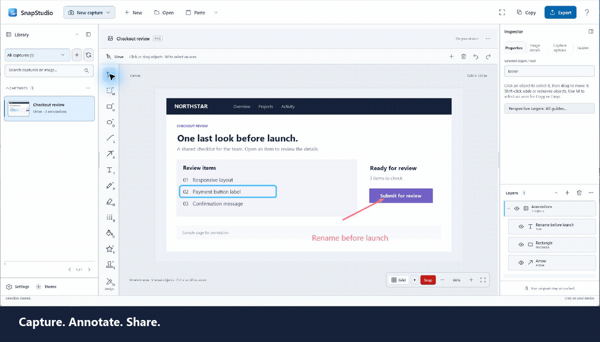

<p align="center">
  
</p>

<h1 align="center">SnapStudio</h1>

<p align="center"><strong>Turn a screenshot into a clear explanation.</strong></p>

<p align="center">
  Capture your screen, point out what matters, and share the result.<br>
  A Windows screenshot editor with editable arrows, notes, shapes, and layers.
</p>

<p align="center">
  <a href="https://github.com/MaxAkbar/SnapStudio/releases/download/v1.1.0/SnapStudio-1.1.0-win-x64-portable.zip"><strong>Download for Windows</strong></a> ·
  <a href="https://github.com/MaxAkbar/SnapStudio/releases/tag/v1.1.0">What's new in 1.1</a> ·
  <a href="docs/help/index.html">User guide</a>
</p>

<p align="center">Windows 11 x64 · Editing works offline · No account required · MIT licensed</p>

<p align="center">
  
</p>

<p align="center"><em>A sample screenshot, annotated in the real SnapStudio app.</em></p>

## From screenshot to something useful

Explain a bug, mark up a design, or show someone what to click. Your annotations stay editable, so you can adjust the message without starting over.

| You want to… | SnapStudio helps you… |
| --- | --- |
| **Grab the right image** | Capture a region, window, monitor, or desktop. Open an image or paste from the clipboard. |
| **Make your point** | Add arrows, text, shapes, highlights, blur, and reusable stamps. Move, resize, and restyle them. |
| **Keep work editable** | Organize layers into folders, group objects, merge selections, and move objects between layers. Undo and redo your changes. |
| **Edit just one area** | Select with a rectangle, ellipse, lasso, polygonal lasso, or magic wand. Copy, fill, mask, or crop a layer. |
| **Line things up** | Snap to edges and centers, use an adjustable grid, or draw with one- through five-point perspective guides. |
| **Share and find it later** | Copy the result or export PNG, JPEG, or PDF. Browse your local library with folders, tags, and search. |

## Get started in a minute

1. **Download and open.** Get the [1.1.0 portable ZIP](https://github.com/MaxAkbar/SnapStudio/releases/download/v1.1.0/SnapStudio-1.1.0-win-x64-portable.zip), extract the **entire archive**, and run **`SnapStudio.App.exe`**.
2. **Capture and annotate.** Press **Ctrl+R** for a region capture, **Ctrl+O** to open an image, or **Ctrl+V** to paste. Choose **Arrow (A)**, **Text (T)**, or **Rectangle (U)** and mark up the image.
3. **Adjust and share.** Use **Move (V)** to reposition objects, change their appearance in Properties, then choose **Copy** or **Export**.

The ZIP includes .NET and the Windows App SDK runtime; Visual Studio and the .NET SDK are not required. Help and the SVG designer need the Microsoft Edge WebView2 Runtime. The download is unsigned, so Windows may show an unrecognized-app warning.

**Need a hand?** Press **F1** for the searchable, offline user guide. See the [release notes](docs/releases/v1.1.0.md) for package details and current limits. OCR, scrolling capture, and screen recording remain experimental and disabled by default.

## Your work stays on your PC

Captures, editable documents, settings, and logs are stored locally. There is no cloud account, subscription, or automatic image upload. Choose your storage location and either JSON sidecars or a local CSharpDB database in Settings.

Optional online icon search sends your search words and requested icon IDs to Iconify; it never uploads your screenshots or documents. Imported icons remain available offline. Read the [privacy disclosure](docs/privacy.md).

## More when you need it

<details>
<summary><strong>Layers, selections, and a comfortable workspace</strong></summary>

- Expand a layer to work with its objects. Ctrl-click rows to select several, then right-click to group, merge, cut, or move them. Merges keep objects editable; folders and object groups cannot be nested.
- Use **Marquee (M)** to isolate pixels. Add or subtract selection areas, move the outline, copy with transparency, fill with **Shift+F5**, add a layer mask, or crop a single layer. **Ctrl+D** clears the selection.
- Switch between **Properties**, **Image details**, **Capture options**, and **Guides** in the Inspector. Layers stay available underneath.
- Resize or collapse either side pane, or press **F8** for Focus mode. The **Theme** button beside Settings switches between light, dark, and system appearance.
- SnapStudio minimizes during screen capture and restores the workspace afterward.

</details>

<details>
<summary><strong>Snapping, perspective, and SVG design</strong></summary>

- **Snap** aligns object edges and centers. **Grid** adds adjustable spacing. Both work on the canvas and in the SVG designer; hold **Alt** to move freely. Guides stay out of exported artwork.
- Choose one- through five-point perspective in **Guides**. Adjust vanishing points, the horizon, and each guide family's color, opacity, density, and visibility. Set the guide families each object can snap to.
- **Perspective line** follows curved guides; **Perspective rectangle** creates an editable face on a Front, Side, or Ground plane. Perspective objects adapt when moved with perspective snapping enabled.
- Create and edit SVG artwork with shapes, text, paths, grouping, duplicate/delete, transforms, and undo/redo. Save artwork as custom tools or stamps.
- Design a **Custom SVG** line motif that repeats along shapes and curves, with adjustable scale and spacing. Save favorite styles under **Design (D)**.

See [supported SVG features](docs/svg-tools.md) and the [user guide](docs/help/index.html).

</details>

<details>
<summary><strong>Stamps and free SVG icons</strong></summary>

Press **S**, choose a stamp, and click the image to place it. Use the built-in symbols and labels, import your own SVG, or save a selected SVG object as a stamp.

Choose **Search online…** in the stamp gallery to find icons through Iconify. Search across collections or filter to Heroicons, Tabler, or Lucide. Review the author, license, and source before adding an icon to your local library. No account or API key is required.

You can also import SVGs downloaded from [Heroicons](https://heroicons.com/), [Tabler Icons](https://tabler.io/icons), [Lucide](https://lucide.dev/), or [SVG Repo](https://www.svgrepo.com/). Check the individual icon's license and keep applicable notices with artwork you redistribute. Right-click a saved icon and choose **Source and license…** to review its attribution.

</details>

<details>
<summary><strong>Build from source and developer documentation</strong></summary>

Use **Windows 11**, the **.NET 10 SDK**, and **Windows SDK 10.0.26100 or newer**.

```powershell
git clone https://github.com/MaxAkbar/SnapStudio.git
cd SnapStudio
dotnet restore SnapStudio.sln
dotnet build SnapStudio.sln --configuration Debug -p:Platform=x64
dotnet test SnapStudio.sln --configuration Debug -p:Platform=x64
```

In Visual Studio, open **`SnapStudio.sln`**, select **x64**, and set **SnapStudio.App** as the startup project. Install the WinUI / Windows App SDK tooling if needed.

- [Development setup](docs/development-setup.md)
- [Packaging and portable builds](docs/packaging.md)
- [Project plan and release gates](docs/project-plan.md)
- [Microsoft Store submission](docs/store-submission.md)
- [SVG designer](docs/svg-tools.md) and [example tool designs](docs/tool-designs.sample.json)
- [Updating the HTML help](docs/help-authoring.md)

</details>

## Feedback and license

[Report a bug or suggest a feature](https://github.com/MaxAkbar/SnapStudio/issues). Include the steps and expected result, and share sample images only when you are comfortable doing so.

SnapStudio is open source under the [MIT License](LICENSE).
