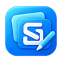

<p align="center">
  
</p>

<h1 align="center">SnapStudio</h1>

<p align="center"><strong>Capture an idea. Make it clear.</strong></p>

<p align="center">
  A Windows screenshot editor for pointing things out, explaining a change,<br>
  and turning a quick capture into something worth sharing.
</p>

<p align="center">
  <a href="https://github.com/MaxAkbar/SnapStudio/releases/tag/v1.0.0">Download version 1.0</a> ·
  <a href="#your-first-screenshot">Get started</a> ·
  <a href="#help-when-you-need-it">User guide</a>
</p>

<p align="center">Windows 11 · Works offline · No account required · MIT licensed</p>

## From screenshot to explanation

- **Capture what matters.** Grab a region, a window, one monitor, or your entire desktop. You can also open an image or paste from the clipboard.
- **Make your point.** Add arrows, text, shapes, highlights, or blur. Move, resize, and restyle your notes as you go, with undo and redo.
- **Keep it editable.** Organize objects in layers and come back to the document later. Even the captured mouse pointer can be moved or hidden on its own.
- **Select precisely.** Use a rectangle, ellipse, freehand lasso, magic wand, or polygonal lasso with straight edges. Copy the selected shape with transparency, or fill it with a color.
- **Find it again.** Browse your local library, group images into folders, and search by title or tag. Map a folder to bring existing images into your workspace.
- **Share the result.** Copy the image to your clipboard or export PNG, JPEG, or PDF. PNG keeps transparent backgrounds.

Your captures stay on your PC. There is no cloud account, automatic upload, or subscription to set up.

## Download SnapStudio 1.0

1. Open the [version 1.0.0 release](https://github.com/MaxAkbar/SnapStudio/releases/tag/v1.0.0).
2. Download **`SnapStudio-1.0.0-win-x64-portable.zip`**.
3. Extract the **entire ZIP**, then run **`SnapStudio.App.exe`** from the extracted folder.

The release runs on **Windows 11 x64** and includes .NET and the Windows App SDK runtime. You do not need Visual Studio or a .NET SDK to run it. The Help viewer and SVG designer require the Microsoft Edge WebView2 Runtime.

**Version 1.0.0 is the first stable GitHub release.** The download is unsigned, so Windows may show an unrecognized-app warning. OCR, scrolling capture, and screen recording remain experimental and disabled by default. See the [release notes](docs/releases/v1.0.0.md) for included features, checksums, and package details.

## Your first screenshot

1. **Start with an image.** Choose **New capture → Region**, or press **Ctrl+R**. Already have a screenshot? Use **Open** (**Ctrl+O**) or **Paste** (**Ctrl+V**).
2. **Add a note.** Choose **Arrow** or **Text** beside the canvas, then draw on the image. Change its color, size, and opacity in **Properties**.
3. **Adjust it.** Use **Move** (**V**) to select and reposition objects. Use the **selection tools** (**M**) to select an image area, then copy it, fill it, or **Crop** (**C**) to keep its bounding rectangle.
4. **Share it.** Choose **Copy** (**Ctrl+C**) or **Export → PNG, JPEG, or PDF**.

**Copy only part of an image:** make a pixel selection first. Areas outside the selected shape stay transparent. To copy the whole edited image, clear the selection with **Ctrl+D**.

## A workspace that grows with your work

The **Library** on the left keeps your images within reach. The canvas is in the middle, and the **Inspector** on the right holds Properties and Layers. Resize or collapse either side pane, or press **F8** for Focus mode.

When you need more than a quick arrow:

- Start a transparent canvas with **New** (**Ctrl+N**), or paste another image as an editable layer.
- Save your favorite tool styles in **Design** (**D**) so your annotations look consistent.
- Create reusable SVG artwork in the built-in designer, then edit an individual object's artwork whenever needed.
- Place reusable symbols, status labels, and your own SVG artwork with **Stamps** (**S**).
- Add tags such as `Design` or `Bug` and find them later with searches like `#Design`.
- Choose **Dark**, **Light**, or **Use system setting** in **Settings → Appearance**.
- In source builds, use **Snap** beside the zoom controls to align moving objects by their edges or centers. Magenta guides show the match. Hold **Alt** to bypass snapping, or turn Snap off for free positioning.
- In source builds, turn on **Grid** beside Snap for an editing grid. Its arrow opens settings for **4–512 px** cell spacing and **Snap to grid**. Dense grids use wider visible spacing at low zoom, and snapping follows those lines. The grid stays out of copied and exported images.
- In source builds, use **Grid** in the SVG designer too, with **4–512 SVG units** of cell spacing and optional grid snapping. The guide stays out of saved and exported SVG artwork.

## Stamps and free SVG icons

Stamps are available in source builds; they are not included in the 1.0.0 download yet.

Press **S**, choose a stamp, then click the image to place it. Keep clicking for more copies. Search the gallery or filter by category, and set the longest edge in image pixels under **Properties → Stamp size**. Press **V** to move or resize a placed stamp. Each placement supports undo and redo.

The gallery includes 16 symbols and labels. Choose **Import SVG** to add a local SVG file to your saved library. You can also select an SVG object and choose **Save as stamp** in Properties or its right-click menu. Right-click a custom gallery item to rename it, change its category, or remove it. Placed copies keep their artwork even after the library item changes or is removed.

To find an icon inside SnapStudio, choose **Search online…** in Stamps. Enter a keyword, choose **All collections**, **Heroicons**, **Tabler**, or **Lucide**, then click **Search** or press **Enter** in the keyword field. Browse the preview pages and select an icon to review its author, license, and source. **Add to stamps** saves the SVG locally and selects it; click the image to place it. Saved icons work offline. Right-click a custom stamp and choose **Source and license…** to review its saved details. The source and license metadata also stay with each placed SVG object.

Online search is optional and needs no account or API key. Opening the dialog, typing, or changing the collection makes no automatic network requests. After you submit with **Search** or **Enter**, search words and requested icon IDs go to **api.iconify.design**, along with ordinary connection information such as your IP address. Screenshots and documents are never uploaded. See the [Iconify API documentation](https://iconify.design/docs/api/) and [privacy disclosure](docs/privacy.md).

You can also download an individual SVG from one of these sites, then import it:

| Source | License |
| --- | --- |
| [Heroicons](https://heroicons.com/) | [MIT](https://github.com/tailwindlabs/heroicons/blob/master/LICENSE) |
| [Tabler Icons](https://tabler.io/icons) | [MIT](https://github.com/tabler/tabler-icons/blob/main/LICENSE) |
| [Lucide](https://lucide.dev/icons/) | [ISC; some inherited icons use MIT](https://lucide.dev/license) |
| [SVG Repo](https://www.svgrepo.com/) | [Varies by icon](https://www.svgrepo.com/page/licensing); check the individual license |

Keep the applicable license notices with artwork you redistribute. SnapStudio imports static vector SVGs; see [supported SVG features](docs/svg-tools.md) for limits.

## Help when you need it

Choose **Help** in the top toolbar or press **F1**. The built-in guide opens beside your work and includes searchable topics, walkthroughs, and the full shortcut reference. It works offline and follows the app's theme.

You can also open [the HTML guide](docs/help/index.html) from a local copy of this repository in your browser.

| Shortcut | Action |
| --- | --- |
| **Ctrl+R** | Capture a screen region |
| **Ctrl+O** / **Ctrl+V** | Open an image / paste |
| **V** / **M** | Move objects / select an image area |
| **A** / **T** / **H** | Arrow / text / highlighter |
| **S** | Open the stamp gallery |
| **Ctrl+Z** / **Ctrl+Y** | Undo / redo |
| **Ctrl+C** / **Ctrl+D** | Copy / deselect |
| **Ctrl+mouse wheel** | Zoom at the pointer |
| **F8** / **F1** | Focus mode / Help |

Editor shortcuts apply outside text fields and dialogs.

## Your files stay yours

Documents are saved under `%LOCALAPPDATA%\SnapStudio\Documents` by default. Choose another location in Settings, and use either JSON sidecars or a local CSharpDB database for editable document metadata.

Images, thumbnails, settings, and logs remain local. Copying or exporting creates a copy you control. Storage location, storage backend, and feature-switch changes take effect after restarting the app.

Read the [privacy disclosure](docs/privacy.md) for the details.

## Build from source

For the latest development features, use **Windows 11**, the **.NET 10 SDK**, and **Windows SDK 10.0.26100 or newer**.

```powershell
git clone https://github.com/MaxAkbar/SnapStudio.git
cd SnapStudio
dotnet restore SnapStudio.sln
dotnet build SnapStudio.sln --configuration Debug -p:Platform=x64
dotnet test SnapStudio.sln --configuration Debug -p:Platform=x64
```

In Visual Studio, open **`SnapStudio.sln`**, select **x64**, set **SnapStudio.App** as the startup project, and run. Install the WinUI / Windows App SDK tooling if it is not already available.

See [development setup](docs/development-setup.md) for prerequisites and validation commands.

<details>
<summary><strong>Project structure and developer documentation</strong></summary>

SnapStudio uses WinUI for the desktop app and Windows APIs for capture. Core workflows, storage, and rendering live in separate projects.

| Project | Responsibility |
| --- | --- |
| `SnapStudio.App` | Desktop UI and application composition |
| `SnapStudio.Core` | Documents, editor commands, settings, and workflows |
| `SnapStudio.Platform.Windows` | Windows capture, clipboard, hotkeys, and shell integration |
| `SnapStudio.Storage` | Local documents, settings, thumbnails, and diagnostics |
| `SnapStudio.Rendering` | Image rendering and raster edits |
| `SnapStudio.Ipc` / `SnapStudio.CaptureHost` | Capture-host communication |
| `tests/SnapStudio.Core.Tests` | Core and adapter tests |

- [Project plan and release gates](docs/project-plan.md)
- [Packaging and portable builds](docs/packaging.md)
- [Microsoft Store submission](docs/store-submission.md)
- [SVG designer and supported SVG features](docs/svg-tools.md)
- [Example tool design pack](docs/tool-designs.sample.json)
- [Updating the HTML help](docs/help-authoring.md)

</details>

## Feedback and license

Found a problem or have an idea? [Open an issue](https://github.com/MaxAkbar/SnapStudio/issues) with the steps and what you expected to happen. Include sample images only when you are comfortable sharing them.

SnapStudio is open source under the [MIT License](LICENSE).
